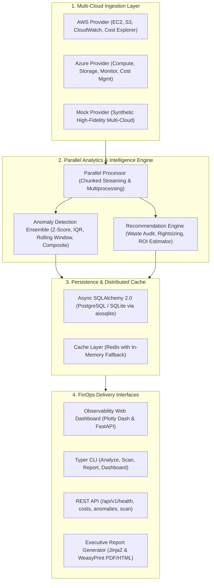

# CloudGuard

**Intelligent Cloud Cost Optimizer & FinOps Observability Platform**

[](https://www.python.org/)
[](https://docs.pytest.org/)
[](https://github.com/Sehaan-1/CloudGuard)
[](https://github.com/astral-sh/ruff)
[](https://www.docker.com/)
[](LICENSE)
[](https://render.com/deploy?repo=https://github.com/Sehaan-1/CloudGuard)

CloudGuard is an enterprise-grade FinOps platform that unifies multi-cloud infrastructure analytics (AWS, Azure, Mock), audits cloud waste (idle compute, orphaned storage, untagged assets), detects spending anomalies via statistical machine learning heuristics, and delivers actionable rightsizing recommendations with projected ROI.

---

## Architecture



---

## Key Features

- **Multi-Cloud Ingestion Strategy**: Unified data model across AWS, Azure, and zero-config deterministic Mock providers.
- **Sub-5s Analytics Performance**: Parallel multiprocessing processor capable of crunching **100,000+ line-item records in under 5 seconds**.
- **Statistical Anomaly Detection**: Ensemble voting combining Z-Score, Interquartile Range (IQR), and Rolling-Window volatility models.
- **Automated Cloud Waste Audit**: Instant detection of idle compute (<5% CPU), unattached / orphaned disks, underutilized VMs, and untagged infrastructure.
- **Actionable Optimization Recommendations**: Priority-ranked recommendations with instant and annual cost savings projections.
- **Interactive FinOps Dashboard**: Dual FastAPI + Plotly Dash interface with real-time KPI cards, cost trend explorer, and anomaly timelines.
- **Executive PDF & HTML Reports**: Publication-ready downloadable reports for C-suite and FinOps stakeholders.
- **Enterprise-Ready DevOps**: Multi-stage Docker container, Docker Compose (App + PostgreSQL + Redis), and 217 automated CI tests.

---

## Quick Start

### 1. Installation

```bash
# Clone the repository
git clone https://github.com/Sehaan-1/CloudGuard.git
cd CloudGuard

# Install in editable mode with development & reporting dependencies
pip install -e ".[dev,postgres,pdf]"
```

### 2. Launch Observability Web Dashboard

Start the full dashboard on port `8050` with instant synthetic FinOps telemetry:

```bash
cloudguard dashboard --host 0.0.0.0 --port 8050
```

- **Dashboard UI**: `http://localhost:8050`
- **Interactive API Docs (Swagger UI)**: `http://localhost:8050/docs`

---

## CLI Commands

CloudGuard provides a Rich terminal CLI with interactive formatters:

```bash
# Analyze 30-day cost consumption and identify top spenders
cloudguard analyze --provider mock --days 30

# Scan infrastructure for idle instances and orphaned disks
cloudguard scan --provider mock --type all

# Detect spending anomalies using composite ensemble voting
cloudguard anomalies --provider mock --method composite

# Generate optimization recommendations
cloudguard recommend --provider mock

# Export executive PDF or HTML report
cloudguard report --provider mock --format pdf --output reports/finops-audit.pdf
```

---

## Docker & Docker Compose

Deploy the production stack (CloudGuard Dashboard, PostgreSQL 16, Redis 7):

```bash
# Copy and configure environment variables
cp .env.example .env

# Spin up all services
docker compose up -d

# Verify service health
curl -f http://localhost:8050/api/v1/health
```

To run standalone with embedded storage:

```bash
docker build -t cloudguard:latest .
docker run -d -p 8050:8050 cloudguard:latest
```

---

## REST API Endpoints

| Method | Endpoint | Description |
|---|---|---|
| `GET` | `/api/v1/health` | Service health status and version |
| `GET` | `/api/v1/costs/summary` | Financial aggregations and service breakdown |
| `GET` | `/api/v1/resources/scan` | Audit scan results (idle, orphaned, waste metrics) |
| `GET` | `/api/v1/anomalies` | Detected cost anomalies with severity classification |
| `GET` | `/api/v1/recommendations` | FinOps rightsizing actions and estimated savings |
| `POST`| `/api/v1/reports/pdf` | Generate and stream executive PDF audit report |

---

## Testing & Verification

Run the comprehensive test suite:

```bash
# Run all 217 unit, integration, performance, and E2E CLI tests
pytest -v

# Run with coverage report (target >= 85%)
pytest --cov=cloudguard --cov-report=term-missing

# Run 100k-record high-volume processing benchmark
python scripts/benchmark.py --records 100000
```

---

## License

Distributed under the MIT License. See [LICENSE](LICENSE) for details.
